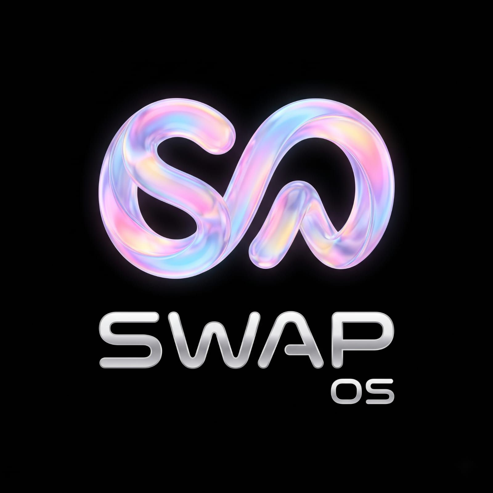

<p align="center">
  
</p>

# SwapOS

SwapOS is a project to build a full, configurable operating system for phones and tablets - one where every part of the experience can be configured by the person using it.

## Current state

The code in this repository today is an early native Android launcher (home screen app) prototype. It is not a full operating system, and it does not replace Android on any device.

The prototype currently includes:

- Home screen with a clock card, favorites grid, and search bar
- App drawer with category filters and a files view
- Built-in wallpaper picker
- SwapOS settings screen with a frosted-glass blur option

## Testing

Testing is limited. The project builds, and its screen layouts have been checked with automated rendering tests. It has not been tested across a range of real devices. This is experimental software, not a finished release.

## Building

Requirements: JDK 17, Android SDK (platform 34), Gradle 8.9.

```
gradle assembleDebug
```

The APK is written to `app/build/outputs/apk/debug/`.

## Roadmap

The long-term goal is a complete, fully configurable operating system. The launcher prototype is the first step toward it.

## License

GNU General Public License v3.0. See LICENSE.
